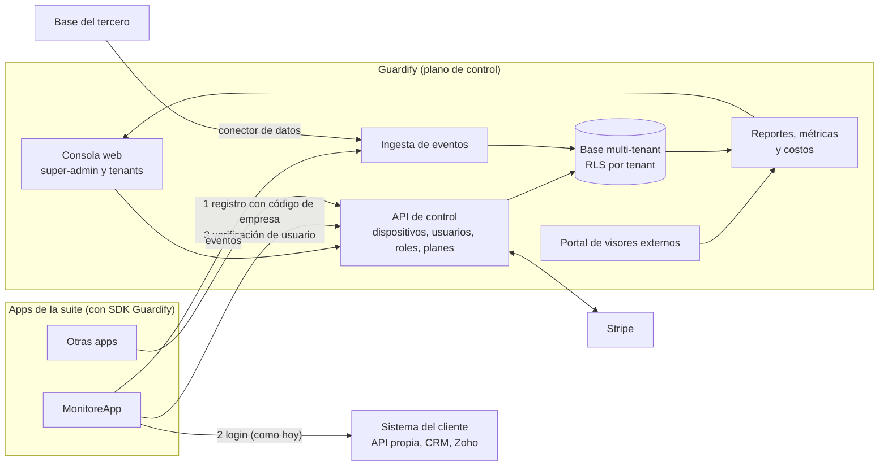
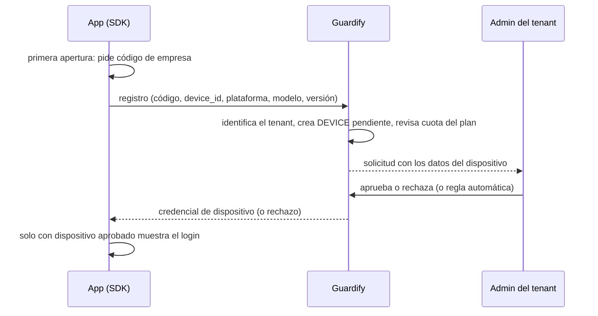
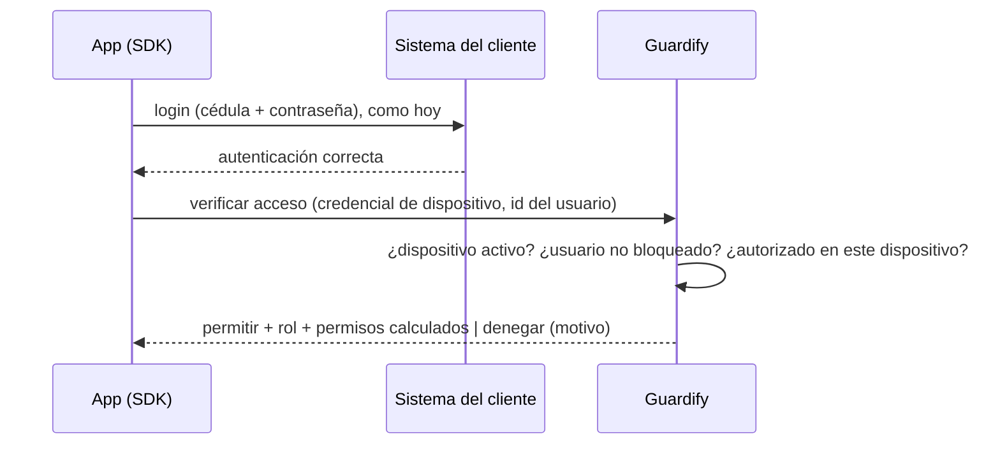
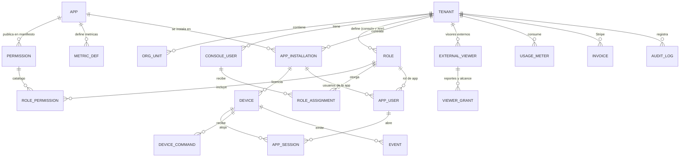
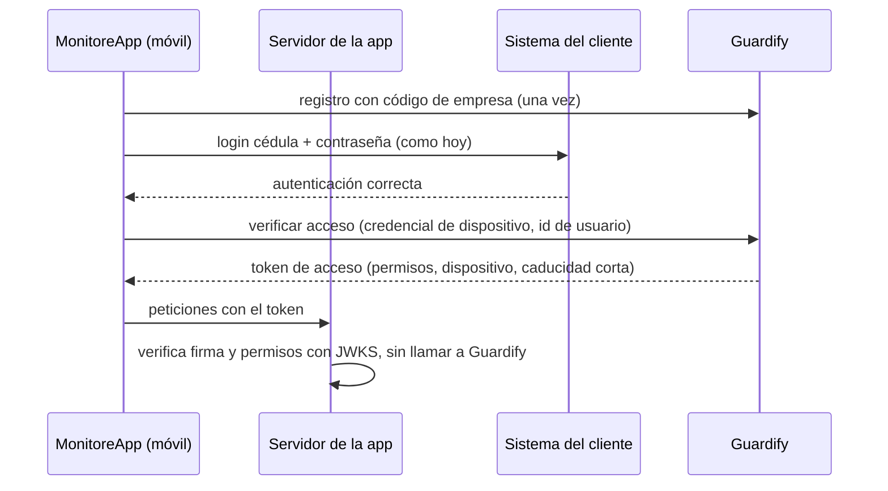
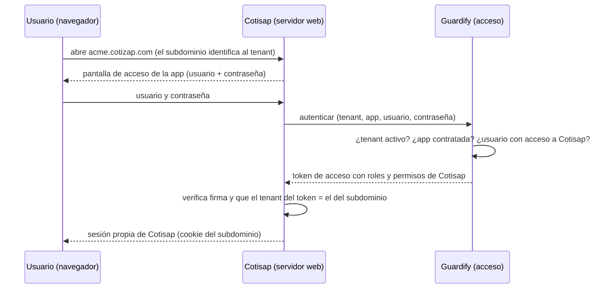

# Guardify — Plano de control multi-tenant para la suite de apps

Estado: **borrador v8 para validación** · Septiembre 2026
Complementa la *Propuesta de servicios 02 (Guardify SaaS)*. Esta versión agrega la **arquitectura de acceso entre Guardify y las apps** (§16): un token, varios tipos de app (móvil, web, escritorio) y RBAC por app.
Documentos relacionados: [plan del dashboard](plan-dashboard.md) y [catálogo de características técnicas](caracteristicas-tecnicas.md).

---

## 1. Qué es Guardify

Guardify es una consola SaaS multi-tenant y un plano de control de las apps de la suite. Cada empresa cliente:

1. **Gobierna dispositivos**: aprueba, habilita, bloquea y retira los equipos donde corren sus apps.
2. **Gobierna a los usuarios de sus apps**: los bloquea o retira **dentro de Guardify** (sin tocar la base del cliente) y define sus **permisos** en cada app.
3. **Define quién puede hacer qué dentro de Guardify** (admins, supervisores, finanzas, auditores…) con roles flexibles.
4. **Ve reportes y métricas** de todo lo que ocurre en sus apps, y entrega reportes a terceros (por ejemplo, el dueño de un condominio) sin darles una cuenta de consola.
5. **Contrata y paga** sus apps en línea (Stripe) y ve cuánto le cuestan.

**Corporación González** gobierna toda la plataforma: crea tenants, ve ingresos, uso y estado de todos.

MonitoreApp es la primera app (un módulo del catálogo). Su cliente piloto tiene la base de usuarios en manos de un tercero. Ese contexto es del piloto, no la regla: otras apps o clientes pueden tener base propia, importarla o usar otra API.

## 2. Hechos y decisiones

| Tema | Decisión / dato | Consecuencia |
|---|---|---|
| Rol de Guardify | **Extensión** de las apps; controla acceso, permisos y reportes | Las apps conservan su propio login y pueden tener su propia base de datos |
| Nivel de control | **Por dispositivo y por usuario** | Un dispositivo bloqueado no opera; un usuario bloqueado no entra a la app en ningún dispositivo (§7) |
| Bloqueo de usuario | Se aplica en Guardify; **no borra nada** en la base del cliente | Guardify guarda el estado del usuario de cada app (§9) |
| Permisos de las apps | **Los administra Guardify**, no el cliente | Los roles de app viven en Guardify (§6.2) |
| Registro | El dispositivo se registra **antes de mostrar el login**, con un **código de empresa** | §7.2 |
| Usuarios de la app | Viven en la base del cliente; el **dispositivo** pertenece a Guardify | Los usuarios se traen bajo demanda, no en bloque (§9) |
| Visores externos | Terceros (p. ej. dueño de un condominio) ven reportes acotados sin ser usuarios de consola | Usuario y contraseña, o token (§6.3) |
| Métricas | **Cada app define las suyas** | Guardify no tiene valor sin ellas; van en el manifiesto (§8.2) |
| Reportería | Datos del SDK **y** de la base del tercero; luego IA y proyecciones | §8 |
| Pagos y precios | Suscripción por uso vía Stripe; **sin precio definido** | Precios configurables como datos (§8.4) |
| Dispositivos | De la empresa o personales; Android e iOS | Capacidades según propiedad (§7.6) |
| Nivel de equipo | Se necesita bloqueo y borrado total | Integrar un MDM, solo para equipos de la empresa (§7.6) |
| Apps móviles de la suite | Un solo código para Android e iOS; MonitoreApp ya usa Expo | El **SDK móvil** se hace en React Native (§13). **Guardify en sí es un dashboard web**, no una app móvil |
| Stack de Guardify | **Next.js** (dashboard web, API y procesos de trabajo); confirmado | Migrar el repo actual (TanStack Start); se pierde la sincronización con Lovable (§14) |
| Conexión | **Conectado y verificado en tiempo real**; sin conexión, la app se bloquea como guardrail | **Cada tenant configura** el modo: cortocircuito, sin tolerancia o por tiempo (§16.12) |
| Login por tenant | Cada app es multi-tenant y cada tenant tiene su login independiente | Planillas solo para el tenant González (§16.10) |
| Entregable actual | **Solo documento** | Sin código hasta validar |

## 3. Principios

1. **Control por dispositivo y por usuario.** Ambos se pueden bloquear de forma independiente, y para operar deben estar habilitados los dos.
2. **Guardify decide permisos; el cliente aporta identidad.** Quién es la persona lo dice el sistema del cliente; qué puede hacer en cada app lo dice Guardify.
3. **Las apps conservan su propio acceso** y pueden tener su propia base de datos. Guardify se integra con un SDK.
4. **Nada se borra en el sistema del cliente.** Bloquear o retirar a un usuario en Guardify solo cambia su estado en Guardify.
5. **Un contrato para todas las apps.** Registro, acceso, comandos, métricas y eventos funcionan igual en cualquier módulo.
6. **Permisos definidos por el cliente sobre un catálogo** que publica cada app.
7. **Guardify ve lo que le reportan** (SDK y conector de datos) y lo convierte en métricas propias de cada app.

## 4. Vista general



## 5. Tres poblaciones de usuarios

| | Usuarios de la consola | Usuarios de la app | Visores externos |
|---|---|---|---|
| Quiénes | Admin del cliente, supervisores, finanzas, auditores, super-admin de la plataforma | Guardas, supervisores de campo, administrativos | Dueño de un condominio, cliente final del tenant |
| Dónde viven | En Guardify | En el sistema del cliente (Guardify guarda su **estado y permisos**) | En Guardify, como accesos limitados |
| Cómo entran | Registro e invitación por correo, 2FA | Login de la app contra el sistema del cliente, más verificación en Guardify | Usuario y contraseña, o token / enlace firmado |
| Qué ven o hacen | Según sus roles y alcance | Usan la app según los permisos que Guardify les da | Solo reportes acotados, solo lectura |

## 6. Roles y permisos

### 6.1 Consola

- **Catálogo de permisos** = `recurso : acción`, publicado por la consola y por el manifiesto de cada app. Ejemplos: `dispositivos:ver`, `dispositivos:aprobar`, `dispositivos:bloquear`, `dispositivos:retirar`, `usuarios-app:bloquear`, `reportes:ver`, `reportes:exportar`, `costos:ver`, `roles:administrar`, `visores:administrar`.
- **Rol** = conjunto de permisos con nombre. Hay **roles de sistema** (plantillas) y **roles personalizados** que cada tenant crea o clona.
- **Asignación** = `usuario × rol × alcance` (tenant, sucursal, grupo de dispositivos o app). Un usuario puede tener varias asignaciones.

| Rol de ejemplo | Permisos | Alcance típico |
|---|---|---|
| Administrador del cliente | todos los de su tenant | tenant |
| Supervisor A | habilitar dispositivos, bloquear usuarios de app, ver reportes | sucursal o grupo |
| Supervisor de reportes | `reportes:ver`, `reportes:exportar` | tenant o app |
| Administrativo de costos | `costos:ver`, `facturacion:ver` | tenant |
| Auditor | solo lectura de reportes y auditoría | tenant |

### 6.2 Permisos de las apps (los administra Guardify)

Los permisos de un usuario **dentro de una app** (por ejemplo, un supervisor en MonitoreApp) **no vienen del sistema del cliente**: se definen en Guardify.

- Cada app publica en su manifiesto sus **módulos y permisos** (por ejemplo, `bitacora:escribir`, `cambio-de-puesto:aprobar`, `rondas:ver`).
- Cada tenant crea **roles de app** (Guarda, Supervisor, Administrativo, los que necesite) con permisos sobre esos módulos.
- Un usuario de la app recibe su rol por **asignación individual**, **en lote** (búsqueda, filtro o carga de una lista), **por grupo** o por **regla** sobre un atributo del cliente (por ejemplo, `cargo = Supervisor`). Con 200 supervisores o 200,000 usuarios, la asignación masiva y las reglas son esenciales; la asignación uno por uno queda para excepciones.
- Lo que la app recibe al iniciar sesión es el **conjunto de permisos ya calculado** (§7.3).

### 6.3 Visores externos

Un tercero que no es usuario de Guardify puede ver información acotada. Ejemplo: el dueño de un condominio recibe el reporte del puesto de seguridad que se le presta.

- **Acceso**: usuario y contraseña propios, o **token / enlace firmado** con caducidad; se puede combinar con envío programado por correo.
- **Alcance**: un cliente, puesto o sucursal, y una lista de reportes concretos. **Solo lectura.**
- **Seguridad**: caducidad, revocación inmediata, límite de tasa, registro de cada acceso en la auditoría y marca del tenant. No accede a la consola ni a otros datos del tenant.
- **Gestión**: los crea y revoca quien tenga `visores:administrar`. Puede contar contra una cuota del plan.

### 6.4 Planos y reglas de seguridad

- **Plataforma** (Corporación González): super-admin, soporte, finanzas de plataforma. Incluye la impersonación de soporte, siempre auditada y visible para el cliente.
- **Tenant**: roles del cliente, que no ven ni afectan a otro tenant.
- **Nadie otorga más de lo que tiene**; los roles nuevos parten vacíos; todo cambio de rol o permiso queda en la auditoría.
- La matriz **rol × módulo** de la Propuesta 01 se conserva como vista de los permisos por app.

## 7. Dispositivos y acceso

### 7.1 Modelo

`DEVICE`: tenant, `app_installation`, identificador de instalación, plataforma, modelo, versión de app, nombre, sucursal o grupo, estado, último contacto, ubicación opcional, y dos atributos clave:

- **`propiedad`**: `empresa` o `personal` (define qué se puede gestionar, §7.6).
- **`modo_uso`**: `compartido` o `asignado`. En una garita, varios guardas usan el mismo equipo por turnos; por defecto **no** se ata a una sola persona. Un equipo `asignado` solo admite a los usuarios autorizados para él.

Estados: `pendiente → activo → bloqueado → retirado`.

### 7.2 Registro con código de empresa (antes del login)

Cada tenant tiene un **código de empresa**. El registro del dispositivo es **lo primero que ocurre**, antes de mostrar la pantalla de login.



- El código **identifica al tenant**, pero **no da acceso**: la aprobación es la barrera real.
- **Aprobación** manual (`dispositivos:aprobar`) o automática por regla (por ejemplo, aprobar mientras haya cupo).
- **Cupo por plan**: máximo de dispositivos por app (por ejemplo, 50). Al llegar al límite, los nuevos quedan en espera y se avisa al admin.
- **Protección del código**: límite de intentos por dispositivo y por IP, tope de solicitudes pendientes, y **rotación** del código. Se pueden emitir códigos por sucursal o **QR de un solo uso** para preregistrar equipos.
- **Retirar**: revoca la credencial; la app deja de operar y puede borrar sus datos locales.

### 7.3 Flujo de acceso de un usuario



- **La contraseña nunca pasa por Guardify** en este flujo: solo el identificador del usuario (por ejemplo, la cédula).
- Guardify puede ofrecer también una **verificación previa** por identificador, antes de que la persona escriba su contraseña, para rechazar de inmediato a un usuario bloqueado.
- Si el usuario **no existe todavía en Guardify**, se crea en este momento (alta bajo demanda, §9) con el rol por defecto del tenant.
- **Apps con backend propio**: Guardify emite un **token de acceso firmado** (usuario, dispositivo, permisos, caducidad corta) que el backend de la app **verifica localmente** con las claves públicas de Guardify. Esto permite exigir el bloqueo también en el servidor.
- **Apps sin servidor propio**: el bloqueo lo aplica el SDK dentro de la app (§7.5). MonitoreApp sí tiene servidor propio (§16.10).

### 7.4 Bloquear, retirar y qué pasa con las sesiones

| Acción en Guardify | Efecto |
|---|---|
| **Bloquear dispositivo** | Nadie puede usarlo, aunque tenga usuario y contraseña válidos |
| **Bloquear usuario** | No puede entrar a la app en **ningún** dispositivo |
| **Retirar usuario** | Igual que bloquear, pero se marca como baja; la base del cliente **no se modifica** |
| **Retirar dispositivo** | Revoca su credencial; opcionalmente borra los datos locales de la app |

Latencia: el cambio se aplica **en la siguiente verificación o renovación** del permiso de uso (minutos), y **de inmediato** con un push que cierra la sesión activa en los dispositivos donde el usuario esté conectado. Sin conexión, la app opera hasta que venza un **periodo de gracia** configurable por tenant.

### 7.5 Dónde se cumple el bloqueo, y sus límites

- **Con backend propio**: el servidor de la app verifica el token de Guardify. Cumplimiento real del lado del servidor.
- **Sin servidor propio**: lo aplica el SDK en la app (no es el caso de MonitoreApp, §16.10). Un equipo con la app modificada o con acceso de administrador podría saltárselo.

Mitigaciones que asume Guardify (el tercero no participa): **atestación** del dispositivo y de la app (Play Integrity en Android, App Attest en iOS), verificación de integridad y ofuscación del SDK, permisos de uso cortos y comandos push. **Riesgo residual aceptado**: un equipo comprometido con acceso a la API del tercero podría seguir usándola; el control de equipo completo (§7.6) lo reduce en los equipos administrados.

### 7.6 Nivel de equipo según propiedad

| Capacidad | Equipo **de la empresa** | Equipo **personal** |
|---|---|---|
| Habilitar/bloquear dispositivo y usuario en la app | Sí | Sí |
| Estado (versión, último contacto, batería, ubicación con consentimiento) | Sí | Sí, con consentimiento |
| Borrado selectivo de los datos de la app | Sí | Sí |
| **Bloquear o borrar todo el equipo** | **Sí**, vía MDM | **No** (a lo sumo, un perfil de trabajo) |

Se necesita bloqueo y borrado total, así que la recomendación es **integrar un MDM en lugar de construirlo**, mediante un adaptador (`proveedor_mdm`):

- **Android**: Android Management API de Google (equipo administrado o perfil de trabajo).
- **iOS**: un MDM comercial (Jamf, Mosyle, Kandji, Intune u otro); varios comandos exigen equipos **supervisados**.

Consecuencias: el equipo de la empresa se enrola en el MDM además de la app; el proveedor cobra por dispositivo (trasladable al plan); es una **fase propia**. En equipos personales el borrado total es delicado legal y humanamente; el atributo `propiedad` evita ofrecerlo donde no aplica. La ubicación y el estado requieren consentimiento y aviso al empleado (Ley 8968, Costa Rica).

## 8. Reportes, métricas y costos

### 8.1 Dos canales de datos

1. **SDK (app → Guardify)**: cada app emite eventos con un esquema común, en lotes y con cola sin conexión.
2. **Conector de datos (base del tercero → Guardify)**: MonitoreApp guarda hoy sus bitácoras y cambios de puesto en la base de un tercero. Un proceso programado, con el acceso que el tercero permita, **extrae, normaliza y carga** esos datos como eventos. Es el trabajo que hoy produce los reportes en Excel, estandarizado y reutilizable.

Cada evento conserva su **origen** (`sdk` o `conector`) para trazabilidad y para evitar duplicados. Ejemplo de evento normalizado:

```json
{
  "tenant": "t01", "app": "monitoreapp", "device": "d123",
  "tipo": "cambio_de_puesto", "ts": "2026-09-19T14:03:00Z",
  "usuario_ref": "id-externo-del-usuario",
  "sucursal": "heredia",
  "datos": { "puesto": "Garita 2", "relevo": "id-externo" }
}
```

### 8.2 Métricas propias de cada app

**Cada app define sus propias métricas** en el manifiesto; sin ellas Guardify sería solo un control de acceso. El manifiesto declara los tipos de evento y, para cada métrica: nombre, fórmula (conteo, suma, promedio, porcentaje, tiempo entre eventos), dimensiones (sucursal, puesto, turno, dispositivo) y umbrales de alerta. El motor las calcula y las muestra sin código nuevo por app.

Candidatas para MonitoreApp, **a validar contigo**: cumplimiento de rondas (%), cambios de puesto por turno, tiempo promedio de relevo, accesos registrados por puesto, incidencias por puesto, dispositivos inactivos, puestos sin cobertura.

### 8.3 Reportes

- **Transversales** a todas las apps del tenant: actividad por dispositivo, sucursal, app y periodo; dispositivos y usuarios bloqueados; cumplimiento.
- **Por app**: los que definan sus métricas.
- Filtros, exportación (CSV/PDF/Excel), programación por correo y **entrega a visores externos** (§6.3).
- Permisos `reportes:ver` y `reportes:exportar` con alcance por sucursal o grupo.

### 8.4 Costos y precios

- **Medición de uso** por tenant y app: dispositivos activos, usuarios activos, eventos ingeridos, almacenamiento, reportes exportados.
- **Vista de costos** para el cliente (`costos:ver`): suscripción, uso, historial de pagos y comprobantes descargables.
- **Vista de plataforma**: ingresos recurrentes, consumo por plan y por tenant, costo de infraestructura atribuible.
- **Precios como datos, no como código**: hoy no hay tarifa definida (suscripción + uso). Planes, cuotas y medidores se configuran en Stripe y en el catálogo de Guardify para cambiarlos sin desarrollo.

### 8.5 Almacenamiento

Eventos en PostgreSQL particionado por tenant y fecha, con tablas agregadas para los tableros; un motor columnar (TimescaleDB o ClickHouse) detrás de la misma interfaz si el volumen lo exige. Retención por plan. Los Excel actuales pasan a ser una **salida** (exportación), no el almacén.

### 8.6 Preparación para IA (fase posterior)

La IA para reportería avanzada y **proyecciones** es una fase aparte (la «fase B» del cliente, distinta de la Fase B de monetización de la Propuesta 02), pero se prepara desde el diseño de datos: capas **crudo → normalizado → curado por tema**; trazabilidad de cada dato (tenant, app, origen); aislamiento estricto por tenant (ningún dato de un cliente alimenta resultados de otro sin acuerdo); y cómputo pesado en procesos de trabajo, fuera de las peticiones de la consola.

## 9. Usuarios de la app: identidad bajo demanda, permisos en Guardify

Guardify **no copia** la base del cliente. Guarda, por cada usuario que realmente aparece, un **registro de usuario de app**: `(tenant, app, id_externo)` + estado (`activo`, `bloqueado`, `retirado`) + rol de app + excepciones. Los datos personales (nombre, cargo) se guardan según la **retención** que elija el tenant: `ninguna` (solo el identificador, como HMAC), `mínima` o `completa`.

Un usuario entra al registro de Guardify por una de estas vías:

1. **Primer ingreso**: la verificación de acceso (§7.3) lo crea con el rol por defecto.
2. **Búsqueda del admin**: por cédula, o listado paginado si la fuente lo permite, para bloquearlo o asignarle un rol antes de que ingrese.
3. **Importación** (fuente importada): carga de archivo o consulta única.

**Capacidades declaradas por fuente**: cada fuente de identidad declara lo que sabe hacer (`consultar_uno`, `listar`, `atributos`, `cambios`); Guardify **no asume más**. El panel se adapta: sin `listar` hay un buscador por cédula; sin `atributos`, la asignación de roles es manual o por lote. El adaptador REST se **configura** (URL, campos, autenticación) y solo si no alcanza se escribe un adaptador específico.

**Rol por defecto** para usuarios no conocidos: configurable por tenant, entre (a) un **rol mínimo** (cualquiera puede entrar con permisos básicos) y (b) **solo usuarios autorizados** (lista blanca; más seguro, más trabajo con 200,000 personas).

**Atributos como semilla**: un atributo del cliente (por ejemplo, el cargo) puede proponer el rol inicial mediante una regla, pero **Guardify decide** los permisos definitivos.

**Sistema del cliente caído**: no afecta al bloqueo ni a los permisos, que viven en Guardify. Solo afecta al login, que sigue siendo del cliente.

## 10. Marketplace, ciclo comercial y multi-tenancy

Cada app es un **módulo** del catálogo con su manifiesto, permisos, métricas, cuotas (por ejemplo, 50 dispositivos en cierto plan) y funciones activables. El tenant ve las apps disponibles, contrata las de su plan o agrega módulos, y cada contratación crea una `APP_INSTALLATION`. Sumar una app nueva a la suite consiste en **publicar su manifiesto y adoptar el SDK**.

1. **Alta**: el super-admin crea el tenant o la empresa se registra sola; crea su organización, sucursales, usuarios de consola y su **código de empresa**.
2. **Pago**: catálogo de planes en Stripe con periodo de prueba, upgrade/downgrade en línea, webhooks de cobro, reintentos y control de impago.
3. **Habilitación**: el plan crea las `APP_INSTALLATION` con sus funciones y cuotas.
4. **Operación**: el tenant aprueba dispositivos, gestiona usuarios de app, asigna roles y consulta reportes.
5. **Impago o suspensión**: los permisos de uso de los dispositivos dejan de renovarse tras el periodo de gracia, con aviso por correo y push.

Aislamiento: `tenant_id` en todo el modelo y en cada endpoint, con **Row-Level Security** en PostgreSQL como segunda barrera; auditoría inmutable por tenant.

## 11. Seguridad, privacidad y datos

- Cifrado en tránsito y en reposo; secretos en gestor de secretos con clave por tenant.
- Credenciales de dispositivo rotativas y revocables; atestación (§7.5).
- Rate limiting, bloqueo por intentos fallidos y 2FA en la consola; los endpoints del SDK y del portal externo tienen credenciales y límites **separados** de la sesión de consola.
- Los secretos de login del cliente **no pasan por Guardify** en el flujo de §7.3.
- Ubicación y estado de dispositivos: consentimiento y aviso al empleado.
- **Legislación de datos**: fuera de foco en v1; el modelo la admite después (retención por tenant, identificadores como hash). Conviene revisarla con asesoría legal antes de operar en cada país.

## 12. Modelo lógico



- `APP_USER`: `(tenant, app_installation, id_externo)`, estado, rol de app, excepciones, origen.
- `APP_SESSION`: usuario en un dispositivo, para poder **cerrar sesiones activas** cuando se bloquea a un usuario.
- `EXTERNAL_VIEWER`: credencial o token, alcance, caducidad y revocación.

## 13. SDK móvil de la suite (React Native / Expo)

**Aclaración:** Guardify es un **dashboard web** y se construye en Next.js (§14); **no existe una app móvil de Guardify**. Esta sección trata solo del **SDK que integran las apps móviles de la suite** (como MonitoreApp), que se distribuye como una librería dentro del monorepo. Los administradores que usen Guardify desde el teléfono lo hacen con el sitio responsivo.

**Recomendación para ese SDK: React Native con Expo**, porque MonitoreApp ya lo usa, salvo que una app futura esté hecha con otra tecnología.

- **Ya lo tienes**: tu monorepo `gonzalez-mobile-monorepo` usa Expo 54 y React Native 0.81 para móvil, con un servidor Next.js 15 + Prisma. Toda tu pila es React y TypeScript.
- **Un lenguaje y contratos compartidos**: el SDK y el servidor de Guardify comparten tipos y validación (por ejemplo, esquemas zod) en un mismo monorepo.
- **Un código para Android e iOS**, con builds y actualizaciones remotas mediante EAS.
- **Lo delicado del SDK es nativo en ambos casos**: atestación (Play Integrity / App Attest), notificaciones push, almacenamiento seguro y configuración administrada por MDM. En Expo requieren **compilaciones de desarrollo** (no Expo Go) y módulos nativos; su disponibilidad y madurez deben confirmarse con una **prueba técnica corta** (registro + push + atestación en un dispositivo real de cada plataforma) antes de comprometer alcance.
- **Flutter** conviene si el equipo ya domina Dart o si hay una app existente en Flutter; costaría un segundo lenguaje y un segundo SDK sin compartir código con Next.js.
- **Regla de diseño**: el SDK es un **protocolo REST documentado (OpenAPI)** más envoltorios finos por tecnología. Empezar con React Native no impide sumar un envoltorio Flutter o nativo después.

## 14. Stack y estructura técnica

**Decisión confirmada: Guardify es un dashboard web y se construye en Next.js.** El repo actual (`guard-desk-nexus`) es TanStack Start sobre Lovable. Las ~10,000 líneas de componentes son React estándar y portables; lo específico son las ~30 rutas de `src/routes` y pocos usos del router. La migración se hace como **primer paso técnico** al arrancar la implementación. Costo asumido: el repo deja de sincronizar con Lovable.

Next.js cubre la consola, el portal de visores externos, la API de control y los webhooks de Stripe. No basta para todo: hay trabajo que no debe vivir dentro de peticiones web y requiere **procesos de trabajo con cola de tareas**, igual que en tus otros proyectos:

- Conector de datos del tercero (extracción programada).
- Envío de push y reintentos.
- Ingesta de eventos en lote y agregación de métricas.
- Generación y envío de reportes.
- Proyecciones con IA (fase posterior).

Estructura propuesta (monorepo):

```
guardify/
├─ apps/console/       Next.js: consola, portal externo, API de control, webhooks
├─ apps/workers/       procesos de trabajo (conector, push, ingesta, reportes)
├─ packages/contracts/ esquemas compartidos (zod / OpenAPI)
├─ packages/sdk-rn/    SDK React Native (Expo)
├─ packages/authz/     can(usuario, permiso, alcance), catálogo de apps, manifiestos
└─ prisma/             modelo multi-tenant (PostgreSQL con Row-Level Security)
```

## 15. Fases y encaje con la Propuesta 02

| Fase | Contenido | Estado |
|---|---|---|
| **0 · Migración a Next.js** | Portar rutas y estructura de monorepo | Nueva |
| **0b · Seguridad de los repos** | Corregir los riesgos hallados en MonitoreApp y Cotizap (§16.10, §16.13). **Prioridad P2** | Nueva, posterior al lanzamiento |
| **0c · Apps a multi-tenant** | Cotizap con subdominio y tenant; servidor de MonitoreApp con adaptador de autenticación por tenant | Nueva |
| A · Núcleo SaaS | Multi-tenancy, jerarquía, autenticación de consola + 2FA | Propuesta 02 |
| **A2 · Roles flexibles** | Catálogo de permisos, roles de consola y de app, asignación con alcance y en lote | Amplía la Propuesta 02 |
| **B2 · Dispositivos, usuarios de app y SDK** | Manifiesto, código de empresa, registro y aprobación, credencial de dispositivo, verificación de acceso, bloqueo, push, atestación | **Nueva, a cotizar** |
| B · Monetización | Planes, Stripe, `APP_INSTALLATION`, cuotas, control de impago | Propuesta 02 |
| **C2 · Ingesta, métricas y reportes** | Eventos, métricas por app, reportes, medición de uso y costos | **Nueva, a cotizar** |
| **C3 · Visores externos** | Portal, credenciales y tokens, entrega programada | **Nueva, a cotizar** |
| C · Operación | Super-admin, dashboards, auditoría, notificaciones, infraestructura | Propuesta 02 |
| D · Go-to-market | Onboarding, planes públicos, API pública | Propuesta 02 |
| **Integración MonitoreApp** | Adopción del SDK, registro, verificación de acceso y eventos | **Nueva, a cotizar** |
| **Conector de datos del tercero** | Extracción y normalización hacia el modelo de eventos | **Nueva, a cotizar** (parte existe en la Propuesta 01) |
| **MDM (equipo completo)** | Adaptador de proveedor MDM: bloqueo, localización, borrado | **Nueva, a cotizar** |
| **Inteligencia (fase B del cliente)** | Reportería avanzada con IA y proyecciones (§8.6) | Posterior |

Orden sugerido: **0 → A + A2 → B2** (lo que el cliente pidió ver funcionando) → **C2/C3** → B → resto.

## 16. Arquitectura de acceso entre Guardify y las apps

Guardify no es solo el plano de control: **la suite completa (Guardify + MonitoreApp + Cotisap + las que vengan) es un producto**. Esta sección define cómo se conectan, sea la app móvil, web o de escritorio.

### 16.1 Idea central: un token, muchos puntos de aplicación

Guardify emite un **token de acceso firmado** con estos datos: tenant, app (la *audiencia*), usuario, dispositivo o sesión, roles, **permisos efectivos**, alcances (sucursal, puesto) y una caducidad corta. Cualquier app lo **verifica localmente** con las claves públicas de Guardify (JWKS), sin llamarla en cada petición.

Lo que cambia entre tipos de app es solo **cómo obtienen el token** y **dónde se aplica**.

### 16.2 Piezas de Guardify

| Pieza | Función |
|---|---|
| **Registro de apps** | Manifiestos (módulos, permisos, métricas, alcances) y contratación por tenant |
| **Servicio de acceso** | Emite y renueva tokens; compatible con estándares (OAuth 2.0 / OpenID Connect: autorización, token, claves, revocación, cierre de sesión) |
| **Registro de dispositivos y sesiones** | Quién está conectado, dónde y desde cuándo |
| **Motor de permisos** | Calcula los permisos efectivos: roles → permisos → alcance |
| **Canal de revocación en tiempo real** | Avisa a apps y servidores cuando algo se bloquea (§16.6) |
| **Librerías de acceso** | Una por tecnología: servidor Node/Next, React, React Native, escritorio |

### 16.3 Tipos de app

| Tipo | Ejemplo | Cómo obtiene el token | Dónde se aplica el control |
|---|---|---|---|
| **Móvil con servidor propio** | MonitoreApp | Registro del dispositivo con código de empresa → login (del cliente o de Guardify) → verificación de acceso en Guardify | **En el servidor de la app** (verifica el token, cumplimiento real) y en el SDK (experiencia y uso sin conexión) |
| **Móvil sin servidor** | apps futuras | Igual | Solo en el SDK (§7.5) |
| **Web** | Cotisap | **Subdominio del tenant** + usuario y contraseña en la pantalla de la propia app; su servidor autentica (contra Guardify o contra el sistema del cliente) y recibe el token (§16.11) | Middleware del servidor + interfaz que oculta lo no permitido. **Sesión independiente por app**, sin inicio de sesión único |
| **Escritorio** | futuras | Registro por código en pantalla (flujo de dispositivo) o registro como el móvil | Servicio local o servidor de la app |

### 16.4 Modo de autenticación por app y por tenant

Cada `APP_INSTALLATION` elige quién autentica; el resultado es el mismo token.

- **`propio`**: la app autentica con el sistema del cliente (MonitoreApp con cédula y contraseña). Después pide a Guardify la **verificación de acceso** con la credencial de dispositivo y el identificador del usuario. **La contraseña no pasa por Guardify.**
- **`guardify`**: Guardify autentica. Sirve para usuarios creados en Guardify (contraseña, 2FA). **No hay inicio de sesión único**: cada app tiene su propia pantalla de acceso y su propia sesión, y el acceso a cada una es una decisión del tenant (§16.7).

Ambos modos coexisten en el mismo tenant y hasta en la misma app.





### 16.5 RBAC por app: el contrato

Cada app trae su **conjunto de reglas y estructuras** en un manifiesto. Guardify lo administra; la app lo cumple.

```yaml
app: cotisap
tipo: web
modulos:
  - id: cotizaciones
    permisos: [ver, crear, editar, aprobar, anular]
  - id: clientes
    permisos: [ver, crear, editar]
roles_plantilla:
  - nombre: Usuario            # rol base, mínimo privilegio
    permisos: [cotizaciones.ver]
  - nombre: Supervisor
    permisos: [cotizaciones.ver, cotizaciones.crear, cotizaciones.aprobar]
alcances: [sucursal]           # dimensiones sobre las que se puede restringir
metricas: [...]
eventos: [...]
```

Reglas del contrato:

1. **Nombres** `modulo.accion`; **denegar por defecto**: lo que no está concedido está prohibido.
2. **Guardify decide el nivel grueso** (app, módulo, acción y alcance). **Cada app aplica las reglas de datos** (por ejemplo, "solo mis registros") usando los alcances del token.
3. La app comprueba permisos en **dos sitios**: la interfaz (para no mostrar lo no permitido) y su **API (la autoridad real)**.
4. Los tenants **clonan y personalizan** los roles plantilla; no editan el manifiesto.
5. **Lista de verificación de integración** para cualquier app nueva: manifiesto publicado, verificación de token, comprobación de permisos en la API, registro y bloqueo de dispositivos, emisión de eventos y métricas, y manejo de revocación.

### 16.6 Revocación inmediata

Un usuario bloqueado **no puede conservar una sesión activa**. Se logra con capas:

| Capa | Mecanismo | Tiempo |
|---|---|---|
| App móvil en primer plano | Conexión en tiempo real (WebSocket/SSE) desde el SDK | Segundos |
| App móvil en segundo plano | Push (FCM/APNs) que cierra la sesión y borra los tokens locales | Segundos |
| Servidor de la app | Guardify notifica la revocación (cierre de sesión por canal trasero y lista de tokens revocados, o consulta de estado) | Segundos |
| Web | Cierre de sesión por canal trasero hacia la app | Segundos |
| Respaldo | Tokens de acceso de vida corta (≈5 min) | ≤ 5 min |

**Límite honesto:** un dispositivo **sin conexión** no puede enterarse. El bloqueo se aplica al reconectar, y el **periodo de gracia sin conexión** (configurable por tenant, incluso en cero para operaciones críticas) fija cuánto puede seguir operando. Con gracia cero, sin conexión la app no opera.

### 16.7 Usuarios: origen, rol por defecto y admisión

Los usuarios pueden ser **nativos** (creados en Guardify, con sus datos separados por tenant mediante `tenant_id` y RLS en una base compartida; una base dedicada por tenant solo si una normativa lo exige) o **externos** (vienen del sistema del cliente). **Siempre es Guardify quien asigna los permisos**; el cargo o rol que informe el cliente es solo una **sugerencia** mediante reglas de mapeo.

**Rol por defecto: empezar por abajo es la práctica correcta** (mínimo privilegio). Precisiones:

- El rol base **«Usuario»** lo define cada app en su manifiesto con lo mínimo para operar; no es "sin acceso".
- **Regla uniforme para todas las apps: sin asignación no hay acceso.** El acceso a cada app se concede de forma explícita, y el tenant decide cómo asignarlo: **individualmente**, **en lote** o **por regla** (por ejemplo, «todos los usuarios con cargo Operativo reciben el rol Usuario en MonitoreApp»). Un usuario puede entrar a una app y no a otra, según lo que decida el tenant.
- **Usuarios nativos** (creados en Guardify): existen solo si un admin los crea o invita, así que la regla se cumple por diseño. **Usuarios externos** (del sistema del cliente) que Guardify aún no conoce: entran solo si una regla del tenant los cubre; si no, quedan `pendientes` hasta que un admin los apruebe. Con reglas amplias equivale a un acceso abierto pero controlado; sin reglas, a una lista blanca. Es la misma política para todas las apps.
- Las reglas pueden **proponer** un rol superior a partir de un atributo del cliente, pero con un **techo** por regla: subir más allá exige aprobación humana. Todo ascenso queda auditado y los roles elevados pueden tener **caducidad**.

### 16.8 Dispositivos compartidos

Es un caso eventual, y el modelo lo soporta: un dispositivo `compartido` admite **varios usuarios**, con **una sesión por usuario**, cambio rápido de usuario y **verificación de acceso en cada inicio de sesión**. Bloquear a un usuario cierra **solo sus sesiones**; bloquear el dispositivo cierra **todas**. La auditoría registra quién usó qué equipo y cuándo.

### 16.9 Métricas y datos de las apps propias

Como MonitoreApp y Cotisap son tuyas y guardan sus métricas en su propia base, **no hace falta que Guardify lea sus bases**: las apps **envían** sus eventos y métricas a la API de ingesta de Guardify con una credencial de aplicación (por lotes, con identificador de evento para evitar duplicados). Guardify también puede **consultar** un endpoint de reportes de la app si es más cómodo. Los datos de **terceros** se obtienen **solo por API** (no hay acceso a bases ajenas), con el mismo modelo de eventos.

### 16.10 MonitoreApp hoy (repo `gonzalez-mobile-monorepo`, rama `prod`)

Lectura del código clonado, sin ejecutar nada.

**Arquitectura.** App Expo (React Native) más un **servidor Next.js 15 con Prisma** en Railway. **MonitoreApp sí tiene servidor propio**, lo que corrige el supuesto anterior (§7.5, §16.3). Ese servidor recibe la cédula y la contraseña, las valida contra la API de **Planillas** (el sistema del tercero) y emite sus propios tokens: acceso de 1 día y renovación de 7 días, además de un token de Planillas con su propia caducidad. Arma los roles del empleado a partir de plazas y divisiones y registra el `sessionId`, el `deviceName` y una marca de inicio de sesión.

**Sesión y «local storage».** La app guarda en `AsyncStorage` el token de acceso, el de renovación, los datos del empleado **con sus roles** y los tokens de Planillas. No usa almacenamiento seguro del sistema.

**Sin conexión, hoy.**
- El **login es solo en línea**. No existe login sin conexión: la app conserva la sesión guardada y sigue operando con ella.
- Renovar el token exige conexión. Sin red, la app no cierra la sesión y sigue funcionando, así que **hoy no hay límite de tiempo sin conexión**: un vencimiento o un bloqueo solo se aplicarían al reconectar.
- Es una app **offline-first**: decenas de módulos con caché local y cola de sincronización (marcas de asistencia, incidentes, bitácoras, visitas, checklists de supervisión, notas, quejas, evaluaciones, archivos). La cola se sincroniza al reconectar y después del login.

**Lo que hoy exige conexión.** Mantenimiento de equipo, Super admins, Entrega de puestos, Nomencladores, Visibilidad de módulos, alta y carga masiva de artículos, búsqueda de puestos, validación de códigos de puesto y Mutuos acuerdos. También el propio login.

**Piezas reutilizables para Guardify.** La app ya envía `deviceName` (marca y modelo) en el login y la renovación, y ya registra el token push (FCM). Son la base natural del registro de dispositivos.

**Riesgos detectados.**
- Tokens y roles guardados sin cifrar. Los roles en caché se usan para decidir permisos sin conexión, así que un equipo con acceso de administrador podría alterarlos.
- Dispositivo compartido: al iniciar sesión, si la última marca de asistencia pertenece a otro empleado, la app borra casi todas las cachés locales (salvo una lista de excepciones). Conviene verificar que no descarte acciones pendientes de sincronizar del usuario anterior.

**Camino de integración.**
1. El servidor de MonitoreApp **verifica tokens de Guardify** y delega en Guardify los roles y permisos (reemplaza el cálculo local de roles y `check-permissions`).
2. La app agrega la pantalla de **código de empresa** y el **registro del dispositivo** antes del login.
3. Reutilizar `deviceName` y el registro push como base del registro de dispositivos.
4. Cifrar la sesión local.
5. Añadir el **límite de gracia sin conexión** y permisos en caché con caducidad firmada.
6. El RBAC actual (tres roles y módulos) se convierte en el primer manifiesto y en los roles plantilla.
7. **Servidor multi-tenant**: hoy está atado a Planillas. El código de empresa elige el adaptador de autenticación: **Planillas solo para el tenant González**; los demás tenants usan su propia fuente o usuarios de Guardify (§16.4).

### 16.11 Identificar al tenant: código de empresa y subdominio

Un **mismo identificador de empresa** (`acme`) sirve en todos los canales:

| Canal | Cómo se informa | Después |
|---|---|---|
| **Móvil** | Primera pantalla: código de empresa | Registro y aprobación del dispositivo, luego login |
| **Web** | Subdominio: `acme.cotizap.com` | Pantalla de acceso de la app con usuario y contraseña |
| **Consola de Guardify** | Subdominio: `acme.guardify.app` (y `admin.guardify.app` para la plataforma) | Login de consola |

Es una buena idea: reutiliza la misma lógica en móvil y web, y las **cookies por subdominio** aíslan las sesiones entre tenants. Cuidados:

- **El subdominio no es un secreto** (se puede adivinar). Mensajes de error genéricos («usuario o contraseña incorrectos»), límite de intentos por usuario y por IP.
- **Subdominios reservados** (`www`, `api`, `admin`…), únicos y estables; si un tenant cambia el suyo, redirección del anterior.
- **DNS y certificado comodín** (`*.cotizap.com`); a futuro, dominio propio del cliente (`cotizar.cliente.com`).
- El servidor de la app debe comprobar que el **tenant del token coincida con el del subdominio**, para que un token de un tenant no sirva en otro.
- **Diferencia móvil/web**: el móvil añade el **registro de dispositivo con aprobación**; la web se controla por **sesión** (y opcionalmente por IP o dispositivos de confianza).
- Si se quiere **rotar** el código de registro móvil, se separa del identificador de empresa (un «código de registro» opcional); el identificador se mantiene estable y la aprobación sigue siendo la barrera real.

### 16.12 Sin conexión: un guardrail configurable por tenant

**Principio: todo va conectado y verificado en tiempo real.** La conexión es la condición normal. Perderla se trata como una **falla**, y la respuesta es un **guardrail** (la app se bloquea), no un parche que finge que todo sigue igual.

**Cómo funciona.** Cuando una app pierde la comunicación con Guardify, sigue confiando en la última verificación durante un tiempo, la **tolerancia sin conexión**, que **configura cada tenant**. Al vencer, la app se bloquea hasta reconectar.

| Modo (lo elige el tenant) | Qué pasa al perder la conexión |
|---|---|
| **`cortocircuito`** | La app se bloquea **al instante** de detectar que no hay conexión |
| **`sin_tolerancia`** | No hay ventana sin conexión: se bloquea al vencer el **permiso de uso vigente**, que es de pocos minutos |
| **`por_tiempo`** (N horas) | Opera **solo las funciones permitidas** hasta N horas; después se bloquea |

Ya no existe la opción «operar sin límite» que hoy tiene MonitoreApp (§16.10). El valor por defecto de la plataforma es `sin_tolerancia`, coherente con el principio de conexión permanente.

**Qué decide cada parte.**
- **La app** declara en su manifiesto qué modos admite y su **máximo** de tolerancia. Cotizap, por ser web, admite solo `cortocircuito` y `sin_tolerancia`.
- **Las funciones permitidas sin conexión** (`permite_sin_conexion`): la app declara cuáles pueden serlo como máximo; el tenant puede **reducir** esa lista, no ampliarla. Todo lo demás exige conexión siempre.
- **El tenant** elige el modo y el valor dentro de esos límites. Puede hacerlo por app y por sucursal.

**Qué significa «bloquearse».**
- La app no permite usar sus funciones y pide reconectar.
- **No borra** lo que el usuario ya registró: los datos pendientes quedan guardados y cifrados en el equipo, y se sincronizan al reconectar.
- Al reconectar se revalidan dispositivo y usuario. Si el usuario fue bloqueado durante la ventana, lo que registró se **acepta y se marca para revisión**, no se descarta en silencio.

**Implementación.**
- Iniciar sesión siempre requiere conexión.
- La tolerancia se mide con la **hora del servidor guardada** más un **reloj monótono** del dispositivo, para que cambiar la hora del teléfono no la evada.
- La consola muestra «sin contacto desde…» por dispositivo.
- El cierre inmediato de sesión por bloqueo (§16.6) no alcanza a un equipo desconectado; la tolerancia define esa ventana.

### 16.13 Cotizap (repo `gonzales`, rama `main`)

- **Arquitectura**: Next.js 15 con Prisma. Login por **correo y contraseña** (bcrypt); la sesión es un **JWT en una cookie** (`auth-token`) que se verifica en el middleware (`jose`), con `userId`, `email` y `rol` en el token.
- **Sin tenant**: hoy es de una sola empresa; el token no lleva identificador de tenant.
- **RBAC** por módulo y acción (`VER_`, `CREAR_`, `EDITAR_`, `ELIMINAR_`) sobre dashboard, usuarios, roles, permisos, clientes, proveedores, artículos, cotizaciones y variables, con roles Administrador y Usuario. El repo incluye además otros módulos (plazas, mano de obra, pólizas, empresas…).
- **Encaje**: el RBAC se traduce directo al formato `modulo.accion` (`cotizaciones.ver`, `cotizaciones.crear`…). Para multi-tenant hay que añadir el tenant al token, aislar los datos por tenant y resolverlo por subdominio (§16.11). **Confirmado como parte del lanzamiento.**
- **Riesgos detectados**: (1) el middleware **escribe en los logs el secreto del JWT y el contenido del token**; (2) el README documenta credenciales de administrador por defecto (`admin@example.com` / `admin123`). Conviene corregirlos antes de producción.

## 17. Decisiones tomadas y preguntas abiertas

**Resueltas:**
- Los dispositivos compartidos son un caso eventual y están soportados (§16.8).
- Rol por defecto: empezar por abajo, con «Usuario» como base (§16.7).
- Usuarios nativos de Guardify o externos con rol sugerido: ambos, y Guardify tiene la última palabra (§16.7).
- Datos de terceros: solo por API (§16.9).
- Sesión activa de un usuario bloqueado: debe cerrarse de inmediato (§16.6).
- Apps de escritorio, móviles y web: un solo contrato de acceso (§16.3).
- Sin inicio de sesión único: cada app tiene su login y su sesión; el acceso lo decide el tenant por app (§16.4, §16.7).
- Web: subdominio del tenant + usuario y contraseña, equivalente al código de empresa del móvil (§16.11).
- Admisión: una sola política para todas las apps; sin asignación no hay acceso (§16.7).
- Tercera app: localización con etiquetas de proximidad (RFID); parte del plan, no es prioridad uno.
- Dominios: por definir; la arquitectura no depende de ellos todavía.
- Repos revisados: MonitoreApp en `prod` y Cotizap en `main` (§16.10, §16.13).
- Guardify es un dashboard web y se construye en Next.js; el SDK móvil es una librería aparte (§13, §14).
- Conexión: todo conectado y verificado en tiempo real; sin conexión la app se bloquea como guardrail (§16.12).
- **Tolerancia sin conexión: la configura cada tenant** (`cortocircuito`, `sin_tolerancia` o `por_tiempo`), y también las funciones permitidas sin conexión (§16.12).
- Cotizap se convierte en multi-tenant con subdominio para el lanzamiento (§16.13).
- **Seguridad de los repos: prioridad P2** (después del lanzamiento); los repos son propios y se corrigen ahí.
- Login por tenant: cada app es multi-tenant y cada tenant tiene su login independiente. MonitoreApp mantiene Planillas **solo para el tenant González** (§16.10).

**Abiertas:**
1. **Modos de tolerancia** (§16.12): interpreté «sin tolerancia» como «se bloquea al vencer el permiso de uso vigente (minutos)» y «cortocircuito» como «se bloquea al instante». ¿Es lo que querías?
2. **Módulos de monitoreo de alarmas del repo actual** (consola, multimonitor, receptoras, flota…): no forman parte del alcance de Guardify. Ver el plan del dashboard (`plan-dashboard.md`).
